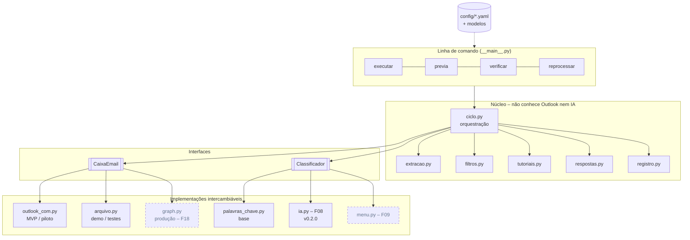
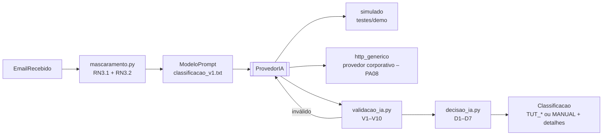
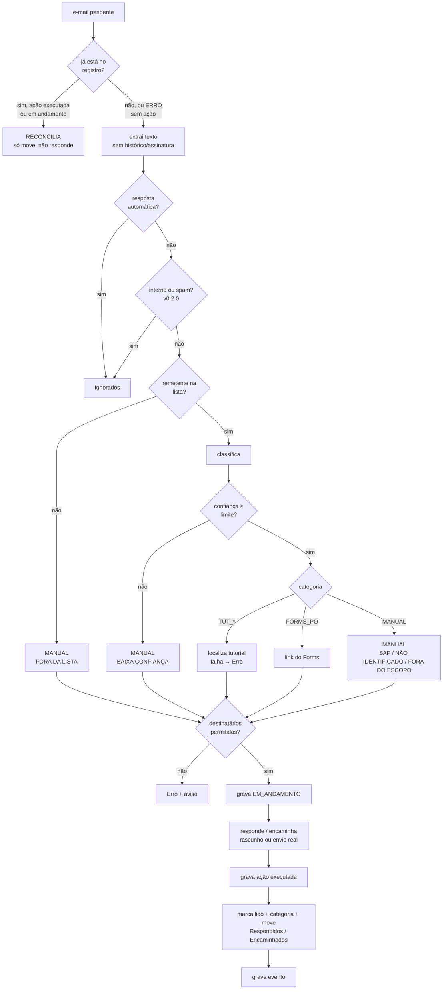

# 02 · Arquitetura

## 1. Visão em camadas



O ciclo só conversa com as **interfaces**. As fábricas `caixa.criar_caixa(cfg)` e `classificacao.criar_classificador(cfg)` escolhem a implementação pelo `caixa.tipo` e pelo `classificacao.tipo` da configuração.

## 2. Interfaces

### `CaixaEmail` (`caixa/base.py`)

| Método | Uso | Requisito |
|---|---|---|
| `ler_pendentes(limite)` | E-mails da pasta de entrada, mais antigos primeiro | RF01, RF02 |
| `responder(email, corpo_html, anexos, cc, responder_todos, enviar)` | Resposta no mesmo fio; `enviar=False` gera rascunho | RF05, RF06, RF07, RF11 |
| `encaminhar(email, para, prefixo_assunto, nota_html, enviar)` | Encaminha o original com a nota interna | RF08 |
| `enviar_novo(para, assunto, corpo_html, enviar)` | Aviso de erro aos analistas | RNF02 |
| `finalizar(email, destino, categoria)` | Marca como lido, aplica a categoria do Outlook e move | RF09 |
| `destinatarios_resposta(email, responder_todos)` | Endereços que vão receber a resposta (usado pela trava) | segurança |
| `verificar()` | Checagem de saúde | — |

### `Classificador` (`classificacao/base.py`)

```python
def classificar(self, assunto: str, corpo: str, email: EmailRecebido | None = None) -> Classificacao
# Classificacao(categoria, confianca 0–1, motivo, motivo_manual?, detalhes{})
```

Desde a v0.2.0 o ciclo passa também o `EmailRecebido` (anexos, histórico, remetente – lacuna R1). O classificador por palavras-chave ignora o parâmetro.

### Classificação por IA (v0.2.0)



| Módulo | Papel |
|---|---|
| `classificacao/ia.py` | `ClassificadorIA`: monta o prompt, chama o provedor (timeout + novas tentativas), pede 1 correção de formato, valida, decide e devolve `Classificacao`. Falha = MANUAL `IA_INDISPONIVEL`, nunca exceção. 5 falhas seguidas desligam a IA no ciclo e geram um aviso |
| `classificacao/provedores_ia.py` | Interface `ProvedorIA` + `ProvedorSimulado` + `ProvedorHttpGenerico` |
| `classificacao/validacao_ia.py` | Regras V1–V10 (funções puras) |
| `classificacao/decisao_ia.py` | `CategoriasIA` (`categorias_ia.yaml`) e regras D1–D7 (funções puras) |
| `mascaramento.py` | CNPJ, CPF, dados bancários, PIX, telefone; truncamento |

A IA **sugere** e o RPA **decide**: a ação final é sempre recalculada pelas regras D1–D7, e a resposta ao fornecedor continua vindo dos modelos `TUT_*.html.j2`.

O **limite de confiança** é aplicado pelo ciclo, não pelo classificador. Assim todas as abordagens são comparadas pela mesma régua.

## 3. Estruturas de dados (`modelos.py`)

- `EmailRecebido`: id, remetente SMTP, assunto, HTML, texto bruto, data, anexos (só os nomes), cabeçalhos, classe da mensagem, mais o `corpo_limpo` e a flag `resposta_automatica`, preenchidos pela extração.
- `Classificacao`: categoria, confiança, motivo, motivo manual (`SAP`, `NAO_IDENTIFICADO`, `BAIXA_CONFIANCA`, `FORA_DA_LISTA`, `FORA_DO_ESCOPO`).
- `Resultado`: ação, status, destino, arquivo enviado, destinatários, erro e duração. Vira uma linha no registro.

## 4. Tratamento de um e-mail (`ciclo.py`)



Qualquer exceção leva o e-mail para `Erro`, grava o motivo e avisa os analistas. O ciclo continua com o próximo e-mail (RNF02).

## 5. Idempotência (RNF01)

A tabela `estado` do SQLite guarda uma linha por e-mail, com a chave no Internet Message-ID:

| Situação ao reencontrar o e-mail na entrada | Comportamento |
|---|---|
| `acao_executada = 1` (respondeu, encaminhou ou gerou rascunho) | **Não repete.** Só move para a pasta registrada |
| `EM_ANDAMENTO` sem ação executada (o ciclo anterior caiu no meio) | Vai para `Erro` com o aviso "verifique se a resposta saiu" |
| `IGNORADO` | Só move |
| `ERRO` sem ação executada | Trata de novo (o analista devolveu o e-mail à entrada) |

O comando `reprocessar PROTOCOLO` libera de propósito um e-mail `SIMULADO` ou `ERRO`. Um `CONCLUIDO` (envio real) **nunca** é liberado.

Há também uma **trava de execução** (`dados/<perfil>/estado.lock`) que impede dois ciclos simultâneos, por exemplo quando o Agendador dispara enquanto o ciclo anterior ainda roda.

## 6. Registro (RF10, RNF03)

| Saída | Conteúdo | Para quê |
|---|---|---|
| `logs/rpa_AAAA-MM-DD.log` | Log técnico, um arquivo por dia | Suporte e diagnóstico |
| `dados/<perfil>/estado.db` | SQLite com `estado`, `eventos`, `ciclos` e, desde a v0.2.0, `respostas_ia` (JSON bruto da IA, acesso restrito). Banco antigo é migrado automaticamente (`ALTER TABLE`) | Fonte da verdade e idempotência |
| `dados/<perfil>/registro_controle.xlsx` | Abas Registro (uma linha por tratamento), Ciclos e Resumo | Auditoria e medição de ganho pela área |

A planilha é gerada de novo a partir do banco ao fim de cada ciclo. Se ela estiver aberta no Excel, o robô só registra um aviso no log e tenta no próximo ciclo. Nada se perde.

## 7. Adaptador Outlook COM: pontos de atenção

- `@inbox` resolve a Caixa de Entrada pelo `GetDefaultFolder(6)`, que funciona em qualquer idioma do Outlook. Por isso nenhum nome como "Caixa de Entrada" fica fixo no código.
- O remetente interno (tipo `EX`) é convertido para SMTP via `GetExchangeUser().PrimarySmtpAddress`.
- Imagens embutidas na assinatura (com `Content-ID`) não contam como anexo.
- A resposta usa `Reply()` e acrescenta os analistas em `CC`. O `ReplyAll()` fica disponível por configuração (`respostas.responder_todos`); ver a decisão D03 no doc 10.
- No modo simulação a mensagem é salva em **Rascunhos** (`Save()`); no envio real usa `Send()`.
- Em caixa compartilhada, `caixa.enviar_em_nome_de` preenche o `SentOnBehalfOfName`.

## 8. Como estender

| Para | Faça |
|---|---|
| Usar o Microsoft Graph (F18) | Criar `caixa/graph.py` implementando `CaixaEmail`, registrar na fábrica e usar `caixa.tipo: graph` |
| Ligar a IA (F08) | Já implementada: `classificacao.tipo: ia` + provedor em `classificacao.ia.provedor` (doc 03) |
| Trocar de provedor de IA | Ajustar `classificacao.ia.provedor.http_generico` no YAML; se o contrato for muito diferente, criar outra classe que implemente `ProvedorIA` e registrá-la em `ia.criar_provedor` |
| Usar o e-mail padronizado (F09) | Implementar como etapa antes do `MANUAL BAIXA_CONFIANCA` no ciclo, mais o modelo `menu_temas.html.j2` |
| Criar uma categoria nova | Incluir em `Categoria`, nos termos, em `tutoriais.yaml` (se for tutorial) e criar o modelo `<CATEGORIA>.html.j2` |

## 9. Bibliotecas

| Biblioteca | Uso |
|---|---|
| `pywin32` | Outlook via COM (só no Windows) |
| `pyyaml` | Configuração |
| `jinja2` | Modelos de resposta (com `StrictUndefined`: variável faltando vira erro, não texto vazio) |
| `beautifulsoup4` | HTML → texto |
| `openpyxl` | Planilha de controle |
| `keyring` | Credenciais no Gerenciador de Credenciais do Windows (uso futuro) |
| `pytest` | Testes |
| `sqlite3` (padrão do Python) | Estado e histórico |
